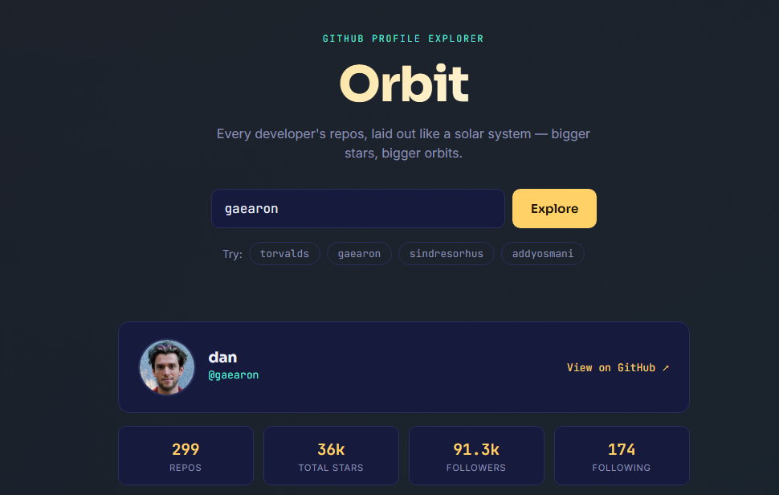

# Orbit — GitHub Profile Explorer

Explore any public GitHub profile as an interactive orbit diagram: repos laid out around the user's avatar, sized by star count and colored by language. No backend, no database, no login.

**[Live demo →](#)** *(add your GitHub Pages link here after deploying)*



## Features

- Look up any public GitHub username and pull their live profile data
- **Orbit visualization** — top 8 non-fork repos plotted around the user's avatar, node size scaled by stars, color-coded by primary language, built from scratch with layout math (no chart library)
- Click or hover a node for repo details: description, stars, language, last updated
- Language breakdown bar showing the share of each language across the user's repos
- Full sortable repo list (by stars, recently updated, or name)
- Handles the real edge cases of a public API: unknown usernames (404), rate limiting (403), and network failures, each with a clear message
- Fully responsive, keyboard accessible (orbit nodes are real buttons, not divs)
- Zero dependencies — vanilla HTML, CSS, and JavaScript

## Why no backend?

The [GitHub REST API](https://docs.github.com/en/rest) serves public profile and repository data over plain HTTPS with CORS enabled, so the browser can call it directly — no server needed to proxy requests or hide a key, because none is required for this kind of read-only public data.

**Rate limit:** unauthenticated requests are capped at 60 per hour, per IP address. That's fine for personal/portfolio use (each search uses 2 requests), but if you hit the limit, GitHub returns a 403 and the app shows a friendly message rather than crashing.

**Note on repo count:** the app fetches up to 100 repositories per user (GitHub's per-page maximum). For users with more than 100 public repos, only the first 100 (sorted by most recently updated) are included in the stats and orbit.

## Run it locally

Clone the repo and open `index.html` in a browser. No build step, no `npm install`.

```bash
git clone https://github.com/<your-username>/orbit-github-explorer.git
cd orbit-github-explorer
open index.html   # or just double-click it
```

If your browser blocks `fetch` on the `file://` protocol, serve it with any static server instead:

```bash
python3 -m http.server 8000
# then visit http://localhost:8000
```

## Deploy to GitHub Pages

1. Push this repo to GitHub.
2. Go to **Settings → Pages**.
3. Under **Build and deployment**, set **Source** to `Deploy from a branch`, pick `main` and `/ (root)`.
4. Save — your app will be live at `https://<your-username>.github.io/<repo-name>/` within a minute or two.

## Project structure

```
orbit-github-explorer/
├── index.html    # markup
├── style.css     # deep-space theme, orbit layout, language bar
├── script.js     # GitHub API calls, orbit math, language aggregation, rendering
└── README.md
```

## Data source

All data comes from the public [GitHub REST API](https://docs.github.com/en/rest), specifically the `/users/{username}` and `/users/{username}/repos` endpoints. No authentication, no API key, no user data is stored — every search is a fresh, live request.

## License

MIT — use this however you'd like.
